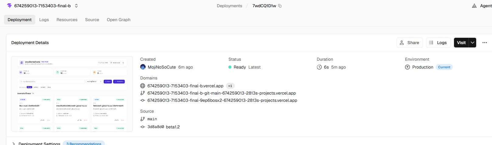
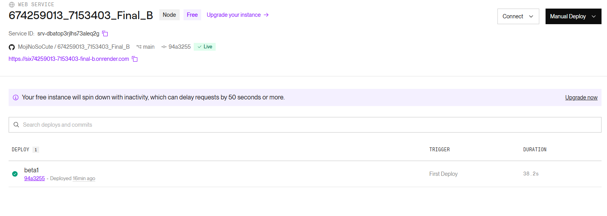
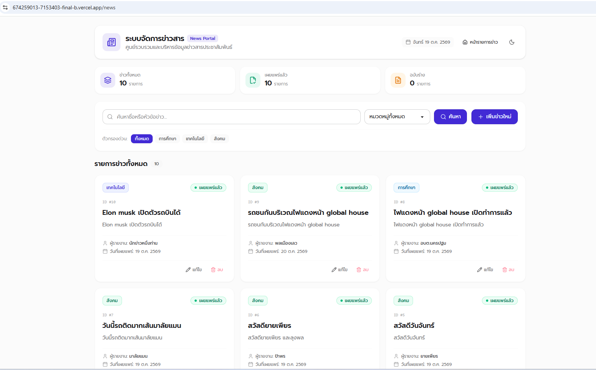
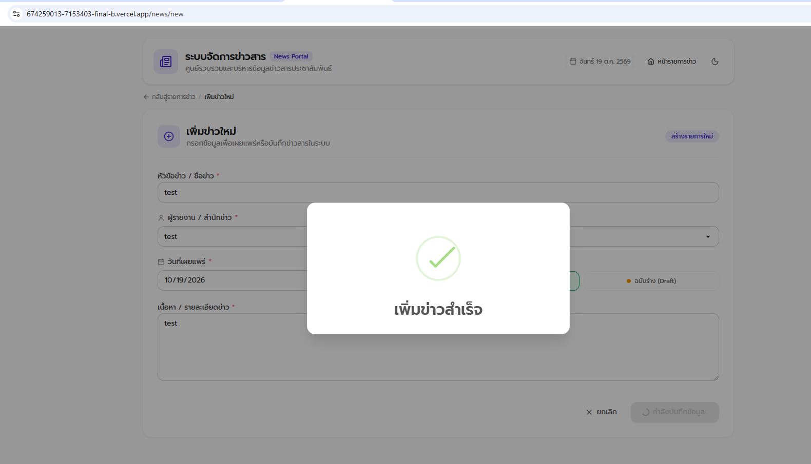
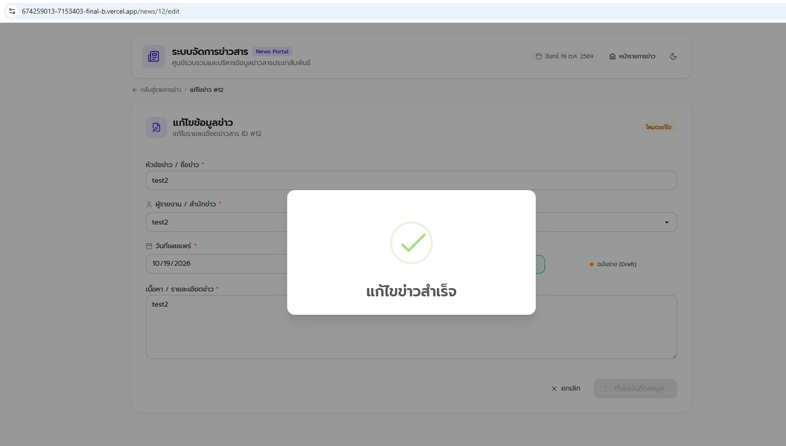
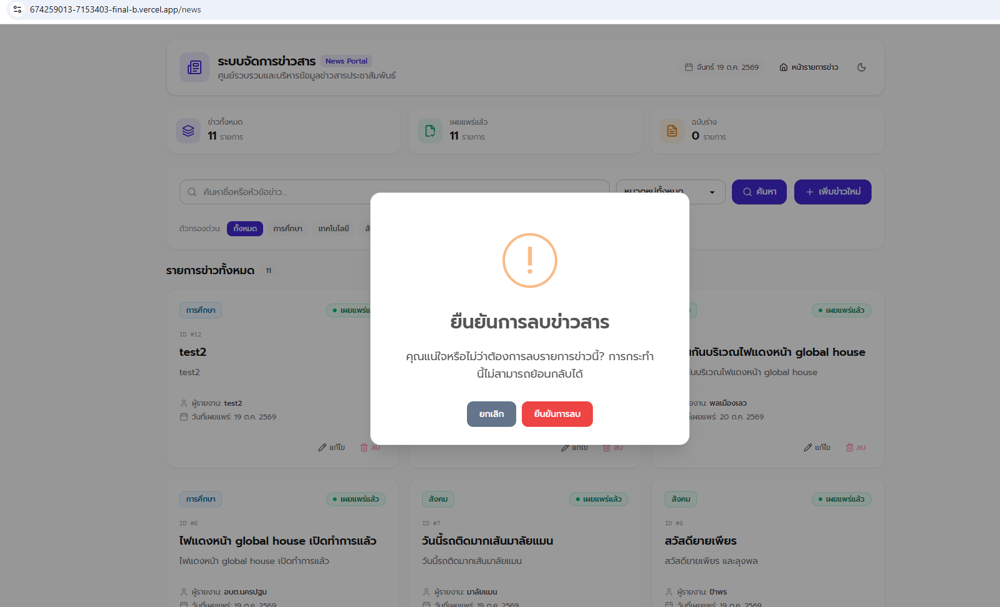
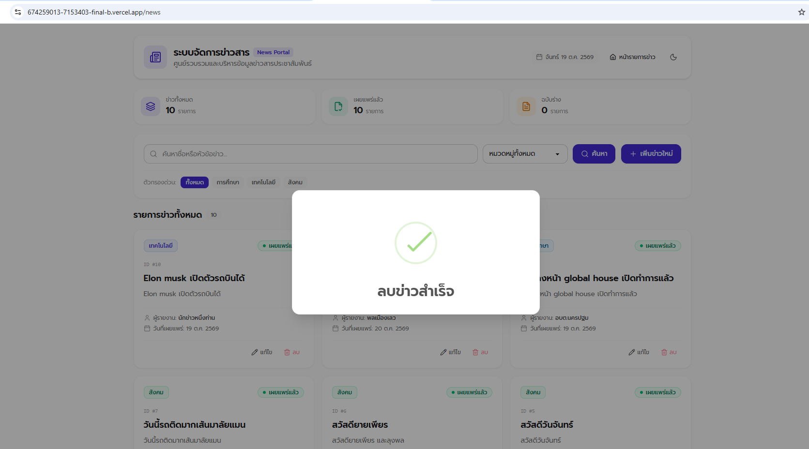

# โจทย์ชุด B : ข่าว

ระบบจัดการข่าวสาร พัฒนาด้วย **Node.js (Express)**, **React.js**, **Tailwind CSS**, **DaisyUI** และ **Sequelize (PostgreSQL)**

---

## รายละเอียดการพัฒนา

- **Backend:** Node.js + Express
- **Frontend:** React.js + Tailwind CSS + DaisyUI
- **Database:** สร้างฐานข้อมูล Sequelize โดยตั้งค่าตัวแปรเชื่อมต่อฐานข้อมูลใน `config/database.js`
- **Model:** สร้างตารางใน `model` เพื่อกำหนดข้อมูลและชนิดข้อมูล
- **Controller:** จัดการการทำงานของแต่ละ Function (เพิ่ม, ลบ, แก้ไข, ค้นหา, กรอง)
- **Router:** จัดการเส้นทาง (Route) ที่ส่งมาให้ถูกต้องกับ Controller

---

## คำสั่งติดตั้ง Dependencies

### 1. คำสั่งติดตั้ง Dependencies ที่ใช้ใน Backend
```bash
npm init -y
npm i express cors dotenv pg pg-hstore sequelize
npm i -D nodemon
```

### 2. คำสั่งสร้าง Frontend และติดตั้ง Dependencies ที่ใช้
```bash
npm create vite@latest frontend -- --template react
cd frontend
npm i react-router sweetalert2 lucide-react tailwindcss @tailwindcss/vite
npm i -D daisyui
```

---

## คำสั่งการรันระบบ

### 1. คำสั่งรันด้วย Docker Compose
```bash
docker compose up -d
```

---

### 2. คำสั่งรันแบบแยกกัน

> **หมายเหตุ:** กรุณาแยก Terminal สำหรับรันแต่ละส่วน

1. **ฐานข้อมูล PostgreSQL:**  
   ต้องรัน PostgreSQL ให้อยู่ที่ port `5432` หรือตามที่กำหนดไว้ใน `.env`

2. **รัน Backend:**
   ```bash
   cd backend
   npm i
   npm run dev
   ```

3. **รัน Frontend:** *(แยก Terminal อีกหน้าต่าง)*
   ```bash
   cd frontend
   npm i
   npm run dev
   ```

## ข้อมูลการเชื่อมต่อระบบ (Deployment Links & Base URL)

- **Frontend (Vercel):** [https://674259013-7153403-final-b.vercel.app](https://674259013-7153403-final-b.vercel.app)

  

- **Backend API (Render - Production):** [https://six74259013-7153403-final-b.onrender.com](https://six74259013-7153403-final-b.onrender.com)

  

- **Backend API (Local Development):** `http://localhost:5000`

---

## ภาพตัวอย่างหน้าจอระบบ (Application Screenshots)

### 1. หน้าแสดงรายการข่าวสาร (News List, Search & Filter)


### 2. หน้าฟอร์มเพิ่มข้อมูลข่าวสารใหม่ (Create News)


### 3. หน้าฟอร์มแก้ไขข้อมูลข่าวสาร (Edit News)


### 4. ป๊อปอัปแจ้งเตือนและยืนยันการลบข่าวสาร (Delete Confirmation)


### 5. ป๊อปอัปแจ้งเตือนเมื่อลบข่าวสารสำเร็จ (Delete Success)


---

## โครงสร้างข้อมูล (Data Model Schema)

ตาราง `News` ในฐานข้อมูล PostgreSQL มีฟิลด์ข้อมูลดังนี้:

| ฟิลด์ (Field) | ชนิดข้อมูล (Data Type) | จำเป็น (Required) | รายละเอียด (Description) |
| :--- | :--- | :---: | :--- |
| `id` | Integer | ✅ (Auto) | รหัสข่าว (Primary Key, Auto Increment) |
| `title` | String | ✅ | หัวข้อข่าว |
| `reporter` | String | ✅ | ผู้สื่อข่าว / ผู้เขียนข่าว |
| `category` | String | ✅ | หมวดหมู่ข่าว (รองรับเฉพาะ: `'การศึกษา'`, `'เทคโนโลยี'`, `'สังคม'`) |
| `publishedDate` | Date | ❌ (Default) | วันที่และเวลาเผยแพร่ข่าว (ค่าเริ่มต้นเป็นเวลาปัจจุบัน) |
| `description` | Text | ✅ | เนื้อหาหรือรายละเอียดของข่าว |
| `status` | Boolean | ✅ | สถานะข่าว (`true` = เผยแพร่แล้ว, `false` = แบบร่าง) |
| `createdAt` | Date | ✅ (Auto) | วันที่และเวลาที่สร้างข้อมูล |
| `updatedAt` | Date | ✅ (Auto) | วันที่และเวลาที่อัปเดตข้อมูลล่าสุด |

---

## ตารางสรุป API Endpoints

> **Base URL:** `https://six74259013-7153403-final-b.onrender.com` (Production) หรือ `http://localhost:5000` (Local)

| Method | Endpoint | คำอธิบาย (Description) | ตัวอย่าง Request URL |
| :---: | :--- | :--- | :--- |
| **GET** | `/` | ตรวจสอบสถานะการทำงานของเซิร์ฟเวอร์ (Health Check) | `https://six74259013-7153403-final-b.onrender.com/` |
| **GET** | `/api/news` | ดึงข้อมูลข่าวทั้งหมด (เรียงลำดับจาก id ล่าสุด) | `https://six74259013-7153403-final-b.onrender.com/api/news` |
| **GET** | `/api/news?search={keyword}` | ค้นหาข่าวตามคำค้นหาในหัวข้อข่าว (Partial Search) | `https://six74259013-7153403-final-b.onrender.com/api/news?search=เทคโนโลยี` |
| **GET** | `/api/news?category={name}` | กรองข่าวตามหมวดหมู่ (Query Parameter) | `https://six74259013-7153403-final-b.onrender.com/api/news?category=เทคโนโลยี` |
| **GET** | `/api/news?search={kw}&category={name}` | ค้นหาพร้อมกรองหมวดหมู่ร่วมกัน | `https://six74259013-7153403-final-b.onrender.com/api/news?search=AI&category=เทคโนโลยี` |
| **GET** | `/api/news/category/:category` | ดึงข้อมูลข่าวตามหมวดหมู่ (Path Parameter) | `https://six74259013-7153403-final-b.onrender.com/api/news/category/เทคโนโลยี` |
| **GET** | `/api/news/:id` | ดึงรายละเอียดข่าวรายชิ้นตาม ID | `https://six74259013-7153403-final-b.onrender.com/api/news/1` |
| **POST** | `/api/news` | เพิ่ม / สร้างข้อมูลข่าวใหม่ | `https://six74259013-7153403-final-b.onrender.com/api/news` |
| **PUT** | `/api/news/:id` | แก้ไข / อัปเดตข้อมูลข่าวตาม ID | `https://six74259013-7153403-final-b.onrender.com/api/news/1` |
| **DELETE** | `/api/news/:id` | ลบข้อมูลข่าวตาม ID | `https://six74259013-7153403-final-b.onrender.com/api/news/1` |

---

## รายละเอียดการใช้งาน API Endpoints แต่ละเส้น (API Specifications)

### 1. Root / Server Status Check
- **Method:** `GET`
- **URL:** `/`
- **คำอธิบาย:** ตรวจสอบความพร้อมการทำงานของ Backend API Server
- **Response:**
  - **Status:** `200 OK`
  - **Content:** `<h>Welcome to Restful API for News Management App</h>`

---

### 2. ดึงข้อมูลข่าวทั้งหมด (Get All News) พร้อมค้นหาและกรอง
- **Method:** `GET`
- **URL:** `/api/news`
- **Query Parameters:**
  - `search` *(optional)*: คำค้นหาในหัวข้อข่าว (`title`) แบบ partial match
  - `category` *(optional)*: หมวดหมู่ข่าว เช่น `การศึกษา`, `เทคโนโลยี`, `สังคม`
- **ตัวอย่าง Request:**
  - ทั้งหมด: `GET https://six74259013-7153403-final-b.onrender.com/api/news`
  - ค้นหา: `GET https://six74259013-7153403-final-b.onrender.com/api/news?search=ปัญญาประดิษฐ์`
  - กรองหมวดหมู่: `GET https://six74259013-7153403-final-b.onrender.com/api/news?category=เทคโนโลยี`
- **ตัวอย่าง Response (`200 OK`):**
  ```json
  [
    {
      "id": 1,
      "title": "ก้าวสำคัญของเทคโนโลยี AI แห่งอนาคต",
      "reporter": "สมชาย ใจดี",
      "category": "เทคโนโลยี",
      "publishedDate": "2026-10-19T08:30:00.000Z",
      "description": "เนื้อหาข่าวเกี่ยวกับนวัตกรรมเทคโนโลยีและการประยุกต์ใช้งานในปัจจุบัน...",
      "status": true,
      "createdAt": "2026-10-19T08:30:00.000Z",
      "updatedAt": "2026-10-19T08:30:00.000Z"
    }
  ]
  ```

---

### 3. ดึงข้อมูลข่าวตาม ID (Get News by ID)
- **Method:** `GET`
- **URL:** `/api/news/:id`
- **Path Parameters:**
  - `id` *(required)*: หมายเลขไอดีของข่าว เช่น `1`
- **ตัวอย่าง Request:**
  - `GET https://six74259013-7153403-final-b.onrender.com/api/news/1`
- **ตัวอย่าง Response:**
  - **Success (`200 OK`):**
    ```json
    {
      "id": 1,
      "title": "ก้าวสำคัญของเทคโนโลยี AI แห่งอนาคต",
      "reporter": "สมชาย ใจดี",
      "category": "เทคโนโลยี",
      "publishedDate": "2026-10-19T08:30:00.000Z",
      "description": "เนื้อหาข่าวเกี่ยวกับนวัตกรรมเทคโนโลยีและการประยุกต์ใช้งานในปัจจุบัน...",
      "status": true,
      "createdAt": "2026-10-19T08:30:00.000Z",
      "updatedAt": "2026-10-19T08:30:00.000Z"
    }
    ```
  - **Error (`404 Not Found`):**
    ```json
    {
      "message": "News not found"
    }
    ```

---

### 4. ดึงข้อมูลข่าวตามหมวดหมู่ (Get News by Category)
- **Method:** `GET`
- **URL:** `/api/news/category/:category`
- **Path Parameters:**
  - `category` *(required)*: หมวดหมู่ข่าว (`การศึกษา`, `เทคโนโลยี`, หรือ `สังคม`)
- **ตัวอย่าง Request:**
  - `GET https://six74259013-7153403-final-b.onrender.com/api/news/category/เทคโนโลยี`
- **ตัวอย่าง Response:**
  - **Success (`200 OK`):** Array รายการข่าวที่อยู่ในหมวดหมู่นั้น
    ```json
    [
      {
        "id": 1,
        "title": "ก้าวสำคัญของเทคโนโลยี AI แห่งอนาคต",
        "reporter": "สมชาย ใจดี",
        "category": "เทคโนโลยี",
        "publishedDate": "2026-10-19T08:30:00.000Z",
        "description": "เนื้อหาข่าวเกี่ยวกับนวัตกรรมเทคโนโลยีและการประยุกต์ใช้งานในปัจจุบัน...",
        "status": true,
        "createdAt": "2026-10-19T08:30:00.000Z",
        "updatedAt": "2026-10-19T08:30:00.000Z"
      }
    ]
    ```
  - **Error (`404 Not Found`):**
    ```json
    {
      "message": "No news found in this category"
    }
    ```

---

### 5. เพิ่มข้อมูลข่าวใหม่ (Create News)
- **Method:** `POST`
- **URL:** `/api/news`
- **Headers:** `Content-Type: application/json`
- **Request Body (JSON):**
  ```json
  {
    "title": "การพัฒนาหลักสูตรการศึกษาในยุคดิจิทัล",
    "reporter": "สมศรี มีสุข",
    "category": "การศึกษา",
    "publishedDate": "2026-10-19",
    "description": "การปรับตัวของการเรียนการสอนให้สอดคล้องกับเทคโนโลยีสมัยใหม่...",
    "status": true
  }
  ```
- **เงื่อนไข Validation:**
  - `title`, `reporter`, `category`, `description`, `status` ห้ามเป็นค่าว่าง
  - `category` ต้องเป็น `'การศึกษา'`, `'เทคโนโลยี'` หรือ `'สังคม'` เท่านั้น
  - `status` ต้องเป็นค่า Boolean (`true` หรือ `false`)
- **ตัวอย่าง Response:**
  - **Success (`201 Created`):**
    ```json
    {
      "id": 2,
      "title": "การพัฒนาหลักสูตรการศึกษาในยุคดิจิทัล",
      "reporter": "สมศรี มีสุข",
      "category": "การศึกษา",
      "publishedDate": "2026-10-19T00:00:00.000Z",
      "description": "การปรับตัวของการเรียนการสอนให้สอดคล้องกับเทคโนโลยีสมัยใหม่...",
      "status": true,
      "updatedAt": "2026-10-19T09:00:00.000Z",
      "createdAt": "2026-10-19T09:00:00.000Z"
    }
    ```
  - **Error (`400 Bad Request`):**
    ```json
    {
      "message": "กรุณากรอกข้อมูลให้ครบถ้วน"
    }
    ```
    หรือ
    ```json
    {
      "message": "หมวดหมู่ต้องเป็น 'การศึกษา', 'เทคโนโลยี' หรือ 'สังคม' เท่านั้น"
    }
    ```

---

### 6. แก้ไข / ปรับปรุงข้อมูลข่าว (Update News)
- **Method:** `PUT`
- **URL:** `/api/news/:id`
- **Path Parameters:**
  - `id` *(required)*: หมายเลขไอดีของข่าวที่ต้องการแก้ไข เช่น `1`
- **Headers:** `Content-Type: application/json`
- **Request Body (JSON):**
  ```json
  {
    "title": "ก้าวสำคัญของเทคโนโลยี AI และ Generative Model",
    "reporter": "สมชาย ใจดี",
    "category": "เทคโนโลยี",
    "publishedDate": "2026-10-19",
    "description": "เนื้อหาข่าวที่ได้รับการอัปเดตข้อมูลเพิ่มเติมล่าสุด...",
    "status": true
  }
  ```
- **ตัวอย่าง Response:**
  - **Success (`200 OK`):**
    ```json
    {
      "id": 1,
      "title": "ก้าวสำคัญของเทคโนโลยี AI และ Generative Model",
      "reporter": "สมชาย ใจดี",
      "category": "เทคโนโลยี",
      "publishedDate": "2026-10-19T00:00:00.000Z",
      "description": "เนื้อหาข่าวที่ได้รับการอัปเดตข้อมูลเพิ่มเติมล่าสุด...",
      "status": true,
      "createdAt": "2026-10-19T08:30:00.000Z",
      "updatedAt": "2026-10-19T09:15:00.000Z"
    }
    ```
  - **Error (`404 Not Found`):**
    ```json
    {
      "message": "News not found"
    }
    ```
  - **Error (`400 Bad Request`):**
    ```json
    {
      "message": "กรุณากรอกข้อมูลให้ครบถ้วน"
    }
    ```

---

### 7. ลบข้อมูลข่าว (Delete News)
- **Method:** `DELETE`
- **URL:** `/api/news/:id`
- **Path Parameters:**
  - `id` *(required)*: หมายเลขไอดีของข่าวที่ต้องการลบ เช่น `1`
- **ตัวอย่าง Request:**
  - `DELETE https://six74259013-7153403-final-b.onrender.com/api/news/1`
- **ตัวอย่าง Response:**
  - **Success (`200 OK`):**
    ```json
    {
      "message": "News is deleted successfully",
      "deleteNews": {
        "id": 1,
        "title": "ก้าวสำคัญของเทคโนโลยี AI และ Generative Model",
        "reporter": "สมชาย ใจดี",
        "category": "เทคโนโลยี",
        "publishedDate": "2026-10-19T00:00:00.000Z",
        "description": "เนื้อหาข่าวที่ได้รับการอัปเดตข้อมูลเพิ่มเติมล่าสุด...",
        "status": true,
        "createdAt": "2026-10-19T08:30:00.000Z",
        "updatedAt": "2026-10-19T09:15:00.000Z"
      }
    }
    ```
  - **Error (`404 Not Found`):**
    ```json
    {
      "message": "News not found"
    }
    ```